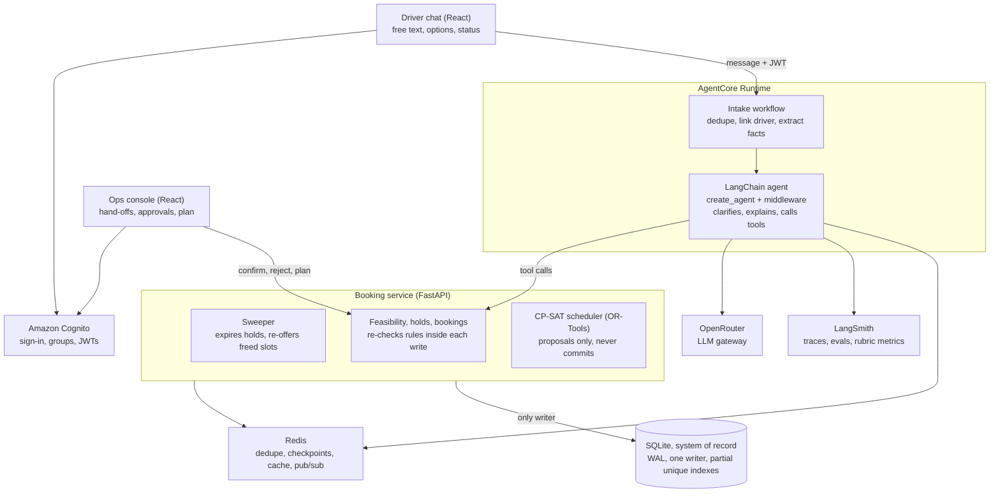
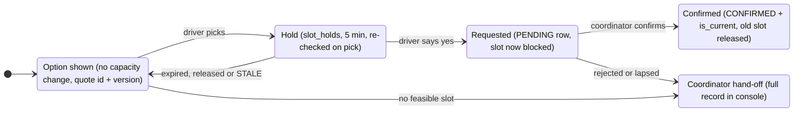

# SetuHaul FDE Challenge — Technical Architecture & Handoffs 1–3

Nov 11, 2026

## Overview

The design rule is simple: **the LLM talks, code decides.** A LangChain agent handles the messy multi-turn driver conversation. Every capacity decision (feasibility, holds, bookings, ranking) runs in deterministic Python against SQLite. The database's partial unique indexes are the last line of defence against double booking.

The brief's scale shapes the stack: 280–360 loads a day, 6 facilities, 32 docks, 190–240 appointments a day, and 20–35 driver messages in a 30-minute spike. That is a low write rate. A single-writer SQLite behind one booking service handles it comfortably, which keeps the concurrency story easy to prove.

### Workflow vs agent, part by part

| Part | Type | Why |
| --- | --- | --- |
| Message intake (dedupe, link to driver, extract facts) | Fixed workflow | Same steps every time; no judgment needed |
| Driver dialogue (clarify, explain, compare options) | Agent | Turn order depends on what the driver says |
| Feasibility, holds, booking, release | Deterministic code + DB transaction | Must be correct under concurrency; never an LLM guess |
| Facility re-sequencing | CP-SAT tool (optional) | Many trucks, many docks, explicit objective |
| Confirmations, no-slot cases, safety | Human (coordinator) | Brief's boundary: a person approves or takes over |

### Stack mapping

| Layer | Technology | Job in SetuHaul |
| --- | --- | --- |
| Frontend | React (Vite + TypeScript) | Driver chat simulator and Ops console (escalation queue, approvals, dock timeline) |
| Identity | Amazon Cognito | User pool with groups `driver`, `coordinator`, `planner`; JWT validated by AgentCore Runtime and the booking API |
| Agent hosting | Amazon Bedrock AgentCore Runtime | Runs the LangChain agent container with JWT inbound auth and per-session isolation |
| Orchestration | LangChain v1 (`create_agent` + middleware) | Tool-calling loop, structured extraction, conversation checkpointing |
| LLM | OpenRouter via ChatOpenRouter (langchain-openrouter), e.g. anthropic/claude-sonnet-4.5; model id is config, so models swap without code changes | Understanding driver text and writing replies only |
| Backend | Python 3.12, FastAPI | Booking service: the only writer to SQLite; exposes tools as HTTP endpoints |
| Database | SQLite (WAL mode) | System of record: the supplied 18 tables plus holds, quotes, handoffs, audit log |
| Cache | Redis | Idempotency keys, read-model cache, rate limits, pub/sub for "option changed" pushes. Never the source of truth for capacity |
| Scheduling | Google OR-Tools CP-SAT | Facility-level proposals for all trucks; returns options, never commits |
| AI observability | LangSmith | Traces per conversation, multi-turn eval datasets from the seeded threads, rubric metrics |

## Handoff 1 — Problem Definition Sheet and data audit

The snapshot has 15 provable data issues; 6 of them would let a naive agent make a wrong promise today. Each issue below cites the query (A1–A15) that proves it, run against `setuhaul_freight_operations.db`.

### Problem statement

How might SetuHaul give drivers a conversational way to report delays, ask questions and consider revised appointments, while many simultaneous requests meet limited dock capacity without infeasible or conflicting promises?

**Primary users:** drivers (chat), warehouse coordinators (confirm, take over), warehouse planner and head of operations (policy, readout). **In scope:** one driver's exception conversation, slot feasibility, holds and bookings, escalation, optional facility re-sequencing. **Out of scope (per brief):** network optimisation, carrier selection, autonomous safety decisions, penalties, customs and hazmat.

### Success measures (from the brief's rubric)

| Measure | Target for the prototype | How measured |
| --- | --- | --- |
| Conflicting or duplicate allocations | 0 | Integrity test + invariant queries |
| Options later found infeasible at confirmation | 0 committed; re-check catches all | Re-validate on every hold and request |
| No-slot cases escalated with a complete hand-off | 100% | Hand-off record has all required fields |
| Driver clarification turns | ≤ 2 per resolved case | LangSmith eval over seeded threads |
| Time from first message to usable outcome | < 3 turns for ladder levels 1–3 | Turns and elapsed time per scenario |
| Share resolved without manual takeover | Report, don't target | Count over scenario set |
| Priority-policy violations | 0 | Each allocation checked against stated policy |

### Facts, estimates, assumptions, unknowns

| Type | Statement | Source |
| --- | --- | --- |
| Fact | 2 facilities, 9 docks, 21 shipments, 106 slots; snapshot is 4 Aug 2026, Asia/Kolkata | DB guide, row counts |
| Fact | DB enforces one active appointment per slot and one current active appointment per shipment | `ux_active_appointment_per_slot`, `ux_current_active_appointment_per_shipment` |
| Fact | Jaipur: reefer loads must use D5; loads above 25,000 kg must use the heavy dock; no new start after 21:00 without approval | RULE003–RULE005 |
| Fact | No live GPS; ETA comes from plan, driver, warehouse or ops override | Brief p.3 |
| Estimate | Driver ETAs: 10 of 11 updates say HIGH confidence, yet they are self-declared | `eta_updates.confidence_code` |
| Estimate | DRV006 cannot unload in Jaipur after 11:20 and reach Gurugram by 14:00 (\~240 km road distance, approximate) | A9 |
| Assumption | A truck needs \~15 min from gate-in to dock-in (SHP1001: 20 min; SHP1002: 7 min) | `facility_checkins` — confirm with gate supervisor |
| Assumption | A standard load may use the heavy dock as a fallback, ranked last | Not stated anywhere — confirm with planner |
| Assumption | Pending warehouse confirmation expires after 15 min or 30 min before slot start, whichever is first | Decision 6 |
| Unknown | What "now" is: records run 07:10–16:30 but morning threads are unanswered | A15 |
| Unknown | Whether a truck within the check-in grace period counts as late (SHP1004 is marked LATE at 25 min, grace is 30) | A11 |
| Unknown | Who owns night-shift escalations at Gurugram (contact vacant, no email) | A13 |
| Unknown | Whether multi-slot bookings (unload longer than slot) are allowed | A6 |

### Data audit

| # | Issue | Evidence (query result) | Design response |
| --- | --- | --- | --- |
| A1 | Confirmed booking violates dock weight limit | APT1005: SHP1005 is 20,500 kg on D3 (max 20,000) | Feasibility checks `load_weight_kg ≤ max_vehicle_weight_kg`; flag existing violations to coordinator |
| A2 | Agent-created pending booking is also overweight | APT1014A: SHP1014 is 21,000 kg on D1 (max 20,000), PENDING via DRIVER\_CHAT | Proves a prior chat flow proposed an infeasible slot; re-validate at request time |
| A3 | Slot partly inside a breakdown is still OPEN | SLOT-JAI-030 (D3 09:00–10:00) open; breakdown DEVT001 starts 09:15 | Availability = slot OPEN **and** no overlapping dock event |
| A4 | Capacity reduction is not reflected in slots | DEVT003 on D2 08:00–09:20; SLOT-JAI-015/016 OPEN | Treat CAPACITY\_REDUCTION as a shift of the dock's free-from time |
| A5 | `docks.dock_status` is stale | D3 and D5 are ACTIVE despite BREAKDOWN and MAINTENANCE events | Never read `dock_status` alone; derive state from events at time *t* |
| A6 | Unload time exceeds slot length | SHP1002 70 min, SHP1005/1009/1014 75 min in 60-min slots | Book consecutive slots on the same dock, or model intervals in CP-SAT |
| A7 | Live shipments with no current appointment | SHP1012, SHP1016 (HIGH), SHP1018, SHP1021 | Agent treats "no appointment" as a state to resolve, not an error |
| A8 | One driver on two in-transit trucks at once | DRV007: SHP1007 (VEH008, ETA 09:50) and SHP1016 (VEH007, ETA 12:00), both IN\_TRANSIT | Contradictory data → human review before booking either |
| A9 | Same truck and driver with an implausible back-to-back | VEH015/DRV006: Jaipur ETA 11:20 + 45 min unload, then Gurugram 14:00 | Flag cross-facility conflicts; ask driver about "next pickup" constraint |
| A10 | Duplicate exception from a messaging retry | EXC001 and EXC009 share dedupe key `DRV006-SHP1006-20260804-0934`; no unique constraint | Idempotency key in Redis + unique index on `dedupe_key` |
| A11 | No-show and status not reconciled | APT1018 NO\_SHOW but SHP1018 still ASSIGNED; same truck VEH003 is waiting in the yard on SHP1003 | Status sync job; no-show explained by the truck's earlier load |
| A12 | Low-confidence ETA treated as fact | SHP1013 "late by one hour" stored as 11:00 and copied to `shipments.latest_eta_ts`; SHP1017 range 12:30–13:00 stored as 12:45 | ETA as a window + confidence; plan on the window's late edge |
| A13 | Escalation channel broken | OM004 to `night.shift@...` FAILED, address is not a facility contact; CON005 has no email | Escalation routes to the Ops console first, email second; failure ≠ confirmation |
| A14 | Confirmed appointment already infeasible | APT1015A (D5 17:00–18:00) CONFIRMED, but ETA is 18:30 and D5 is in maintenance 18:00–22:00 | Every ETA update re-checks the current appointment |
| A15 | Snapshot has no single "now" | Latest record 16:30 (THR005); 09:xx threads still open | Inject a simulated clock into every tool |

**What the two DB rules do not cover:** booking a BLOCKED slot, an incompatible or overweight dock, a slot in another facility, overlapping intervals when unload runs past the slot, holds that never expire, and duplicate exceptions. Code must cover these.

```sql
-- A1, A2, A6: active/pending appointments vs dock limits and slot length
SELECT a.appointment_id, a.shipment_id, a.appointment_status, d.dock_code,
       d.max_vehicle_weight_kg, s.load_weight_kg, s.expected_unload_min,
       (strftime('%s', substr(sl.slot_end_ts,1,19)) - strftime('%s', substr(sl.slot_start_ts,1,19)))/60 AS slot_min
FROM appointments a
JOIN appointment_slots sl USING (slot_id)
JOIN docks d ON d.dock_id = sl.dock_id
JOIN shipments s USING (shipment_id)
WHERE a.appointment_status IN ('PENDING_CONFIRMATION','CONFIRMED','IN_PROGRESS')
  AND (s.load_weight_kg > d.max_vehicle_weight_kg OR s.expected_unload_min > 
       (strftime('%s', substr(sl.slot_end_ts,1,19)) - strftime('%s', substr(sl.slot_start_ts,1,19)))/60);

-- A3, A4: slots overlapping dock events, with their status
SELECT e.dock_event_id, e.event_type, sl.slot_id, sl.slot_start_ts, sl.slot_status
FROM dock_status_events e
JOIN appointment_slots sl ON sl.dock_id = e.dock_id
WHERE sl.slot_start_ts < e.event_end_ts AND sl.slot_end_ts > e.event_start_ts
  AND sl.slot_status = 'OPEN';

-- A5: dock status vs events
SELECT d.dock_code, d.dock_status, e.event_type, e.event_start_ts, e.event_end_ts
FROM docks d JOIN dock_status_events e USING (dock_id);

-- A7: live shipments with no current active appointment
SELECT s.shipment_id, s.current_status, s.priority_code FROM shipments s
WHERE s.current_status NOT IN ('COMPLETED','CANCELLED')
  AND NOT EXISTS (SELECT 1 FROM appointments a WHERE a.shipment_id = s.shipment_id
    AND a.is_current = 1 AND a.appointment_status IN ('PENDING_CONFIRMATION','CONFIRMED','IN_PROGRESS'));

-- A8, A9: drivers or vehicles on more than one live shipment
SELECT driver_id, vehicle_id, shipment_id, current_status, latest_eta_ts, destination_facility_id
FROM shipments
WHERE current_status NOT IN ('COMPLETED','CANCELLED')
  AND (driver_id IN (SELECT driver_id FROM shipments WHERE current_status NOT IN ('COMPLETED','CANCELLED') GROUP BY driver_id HAVING COUNT(*) > 1)
    OR vehicle_id IN (SELECT vehicle_id FROM shipments WHERE current_status NOT IN ('COMPLETED','CANCELLED') GROUP BY vehicle_id HAVING COUNT(*) > 1))
ORDER BY driver_id, latest_eta_ts;

-- A10: duplicate dedupe keys
SELECT dedupe_key, GROUP_CONCAT(exception_id || ':' || exception_status)
FROM driver_exceptions GROUP BY dedupe_key HAVING COUNT(*) > 1;

-- A11: no-show appointment vs shipment status and truck location
SELECT a.appointment_id, s.shipment_id, s.current_status, s.vehicle_id, fc.queue_state
FROM appointments a JOIN shipments s USING (shipment_id)
LEFT JOIN shipments s2 ON s2.vehicle_id = s.vehicle_id AND s2.shipment_id <> s.shipment_id
LEFT JOIN facility_checkins fc ON fc.shipment_id = s2.shipment_id
WHERE a.appointment_status = 'NO_SHOW';

-- A12: low-confidence or range ETAs used as effective ETA
SELECT v.shipment_id, v.effective_eta_ts, v.eta_confidence, v.eta_note, s.latest_eta_ts
FROM v_latest_eta v JOIN shipments s USING (shipment_id)
WHERE v.eta_confidence = 'LOW';

-- A13: operational emails to unknown recipients, and contacts without email
SELECT operational_message_id, recipient_address, delivery_status FROM operational_messages
WHERE channel = 'EMAIL' AND recipient_address NOT IN (SELECT email FROM facility_contacts WHERE email IS NOT NULL);
SELECT contact_id, contact_role, contact_name FROM facility_contacts WHERE email IS NULL;

-- A14: current appointment ends before the effective ETA, or sits in a dock event
SELECT v.shipment_id, v.effective_eta_ts, sl.slot_start_ts, sl.slot_end_ts, e.event_type
FROM v_inbound_operational_state v
JOIN appointment_slots sl USING (slot_id)
LEFT JOIN dock_status_events e ON e.dock_id = sl.dock_id
  AND sl.slot_start_ts < e.event_end_ts AND sl.slot_end_ts > e.event_start_ts
WHERE v.effective_eta_ts > sl.slot_end_ts OR e.dock_event_id IS NOT NULL;

-- A15: time span of the snapshot
SELECT MIN(t), MAX(t) FROM (
  SELECT message_ts AS t FROM chat_messages UNION ALL
  SELECT created_at FROM eta_updates UNION ALL
  SELECT updated_at FROM appointments);
```

## Handoff 2 — Decision register

All 13 decisions are answered so that code, not the model, owns capacity: options are read-only quotes, a slot is taken only by a database transaction, and a person confirms or takes over wherever money, safety or a missing slot is involved.

### Understand

| # | Decision | Our answer | Why | Evidence to bring |
| --- | --- | --- | --- | --- |
| 1 | What to collect before showing options | Ask the driver only for: which load (if more than one is live), revised arrival as a time or window, whether the cause is fixed, latest finish or leave-by time, and see vs book. Look up everything else: appointment, priority, weight, dock type, check-in state | Asking for backend facts wastes turns; trusting the driver over the backend causes wrong promises | THR003 ("late by one hour" → ask for the time), THR010 (two loads → ask which), THR002 ("leave before 1:30" → ask gate-out vs unload start) |
| 2 | Linking a conversation to driver, shipment, appointment | Cognito `sub` → `driver_id` (phone verified at sign-up). Code lists the driver's live shipments. One → link silently. Two or more → ask by order reference and time. Cancelled → say so and route to dispatch. `chat_threads.shipment_id` is written only after the link is certain | One driver can hold two loads; the LLM must never guess the join | Trace for THR010: DRV004 → SHP1004 (WAITING, in yard) and SHP1020 (ASSIGNED, 18:00) → agent asks → driver picks → thread linked → APT1004 |
| 3 | Setting the revised ETA and its certainty | ETA = a window `[eta_lo, eta_hi]` + confidence. Precedence: gate-in (fact) > ops override > warehouse estimate > latest driver update > original plan. Vague phrases get LOW confidence and one clarifying question. A repair time is not an arrival: ask for total delay. Feasibility always uses `eta_hi` + 15 min gate-to-dock | `v_latest_eta` ranks only by recency and ignores confidence (A12) | SHP1006: 10:50 then 11:20 → window 11:20, HIGH. SHP1017: "12:30–13:00" → window 12:30–13:00, LOW, plan on 13:00 |

### Decide

| # | Decision | Our answer | Why | Evidence to bring |
| --- | --- | --- | --- | --- |
| 4 | What makes a slot feasible | `check_feasibility(shipment, slots, now)` in Python, all must pass: same facility; slot OPEN; no overlapping dock event; dock type matches (reefer → D5; > 25,000 kg → heavy); load ≤ dock max weight; start ≥ `eta_hi` + 15 min and ≥ now; enough consecutive time for `expected_unload_min`; finish ≤ driver's latest; start ≤ 21:00 or flagged for approval; no active appointment or live hold on any slot used | Many rules apply at once; an empty row is not a feasible slot (A1–A6) | Written check run on SHP1010 (reefer → D5 only), SHP1014 (21,000 kg → D2/D4 only, D1 rejected), SHP1016 (31,000 kg, 90 min → D6 only) |
| 5 | What "available" means while another driver decides | Available = slot OPEN, no dock event, no active appointment, no unexpired hold. Showing an option reserves nothing. Each option carries a quote id and the slot's version number so the system can tell at pick time whether it changed | Two readers can see one slot; only a write can claim it | Definition above + `slot_holds` and `slot_version` (Handoff 3) |

### Commit

| # | Decision | Our answer | Why | Evidence to bring |
| --- | --- | --- | --- | --- |
| 6 | When an option becomes a hold, request or booking | **Option** (agent shows it; no change). **Hold** (driver picks one; booking service inserts a 5-min hold after re-checking feasibility). **Request** (driver says yes; new appointment row PENDING\_CONFIRMATION with `is_current = 0` and `replaced_appointment_id` = old one; the unique index now blocks the slot). **Confirmed** (coordinator confirms in the console, or an auto-confirm rule passes; one transaction swaps old → CANCELLED, new → CONFIRMED + `is_current = 1`). Pending expires at 15 min or 30 min before slot start, whichever is first, then escalates. A failed email is never a confirmation | Showing is not reserving, reserving is not confirming. Keeping the old appointment current until the swap means the driver is never left with nothing | State diagram in Handoff 3; driver messages: "Holding D4 at 12:00 for 5 minutes" → "Requested, waiting for the warehouse. Keep your current slot until I confirm" → "Confirmed: D4, 12:00–13:00" |
| 7 | Ordering simultaneous requests when capacity is short | **Normal mode:** first valid commit wins (the DB decides). **Surge mode** (≥ 5 open exceptions at a facility within 30 min): requests for the same window are batched for 2 minutes, then allocated by: priority (CRITICAL > HIGH > NORMAL > LOW) → keep already-confirmed commitments → earliest feasible arrival → time already waited → request time. Physical early arrival never displaces scheduled work | First-come is fair when capacity is loose; in a wave it lets a LOW load beat a CRITICAL one by typing faster | Policy test on SHP1006 (HIGH), SHP1012 (NORMAL), SHP1013 (NORMAL, LOW-confidence ETA), SHP1014 (CRITICAL) and SHP1009 (CRITICAL) chasing 11:00–13:00 standard slots |
| 8 | When the facility schedule recalculates (optional) | Triggers: ETA change that breaks the current slot, gate-in, dock event, cancellation or no-show, unload overrun > 15 min. Fixed: IN\_PROGRESS work, trucks CALLED\_TO\_DOCK, confirmed slots starting within 60 min (frozen horizon). Objective: least priority-weighted lateness vs promised time, then least waiting, then fewest changes to promises already given | Changes ripple through the day; drivers lose trust if promises churn | Replay: SHP1002 overrun on D2 + SHP1003 early + SHP1004 late + SHP1005 on broken D3 + SHP1006 late ETA |
| 9 | Stale options, cancellations, duplicates, retries | Duplicates: idempotency key (`external_message_id`, else hash of driver + text + 2-min bucket) via Redis `SET NX`, plus a unique index on `dedupe_key`. Stale: re-check feasibility and slot version at hold and at request; if it changed, say so and show fresh options. Cancellations: a freed slot publishes an event; open exceptions it now fits are re-offered by priority. Retries: every write tool takes an idempotency key | Chat channels repeat messages; retries must not double-book | THR001/THR009 (duplicate), APT1008 cancellation frees D2 10:00, SHP1019 cancelled-shipment question |

### Fail safely

| # | Decision | Our answer | Why | Evidence to bring |
| --- | --- | --- | --- | --- |
| 10 | No feasible slot | Agent says so plainly, says what was checked and what happens next, and never invents a slot. Code creates a hand-off record: shipment, driver, ETA window + confidence, driver constraints, every compatible dock with its rejection reason, nearest out-of-policy option (e.g. after 21:00, next morning), contact routed to and channel status | An invented answer is worse than an escalation | SHP1015 / THR005: reefer D5 maintenance 18:00–22:00, ETA 18:30, current slot 17:00–18:00 missed → hand-off to Jaipur shift manager via console (email path failed, A13) |
| 11 | Saying no to a preferred slot | One plain reason, one alternative, no blame | Refusals without a reason cost trust | "D2 at 11:00 was just taken by another truck. The next slot that fits your load is D4 at 12:00. Want me to hold it?" · "Arriving early doesn't move you ahead of trucks already booked. If a dock frees up before 9:00 I'll offer it to you." |
| 12 | Human approval or takeover | Coordinator approves: any confirmation without an auto-confirm rule, start after 21:00 (RULE005), standard load on the heavy dock. Coordinator takes over: no feasible slot, contradictory data (A8, A9), driver safety or breakdown not fixed, penalties or customer commitments, disputes, 2+ failed clarifications | Safety, penalties and disputes carry risk the agent must not own | Trigger list enforced in code (`requires_human()`), each producing a hand-off record |

### Prove

| # | Decision | Our answer | Why | Evidence to bring |
| --- | --- | --- | --- | --- |
| 13 | Proving no double booking | Integrity test: 10 concurrent clients (threads and separate processes) call `request_booking` for the same slot through the HTTP API. Assert exactly 1 success and 9 `SLOT_TAKEN`. Then run invariant queries: ≤ 1 active appointment per slot, no overlapping intervals per dock (covers multi-slot bookings), ≤ 1 current active appointment per shipment, no live hold on a booked slot. Repeat 100 times with random jitter; also run the same race against holds | The business trusts the allocation only with evidence | `pytest tests/integrity/` output + invariant query results, attached to the readout |

## Handoff 3 — Working prototype architecture

The prototype has five runtime parts: a React app, a LangChain agent on AgentCore Runtime, one FastAPI booking service that alone owns the SQLite file, Redis, and an OR-Tools scheduling module inside the booking service. The agent never touches the database; it calls tools that call the booking service.

### System architecture



Only the booking service writes capacity. The agent reaches it through tool calls; driver id comes from the verified token, never from the model.

The driver's message passes Cognito-issued JWT checks into AgentCore Runtime; the agent can only reach capacity through tool calls to the booking service, which is the sole writer to SQLite.

### Components

| Component | Job | Tech | Serves |
| --- | --- | --- | --- |
| Driver chat | Drivers send free text, see options, holds and status; streams agent replies | React + TypeScript, Cognito auth library | Scenario steps 1–5 |
| Ops console | Escalation queue with hand-off records, confirm/reject pending bookings, dock timeline per facility, CP-SAT proposal vs current plan | React; live updates via server-sent events fed by Redis pub/sub | Decisions 6, 10, 12 |
| Intake workflow | Fixed steps per message: idempotency check, driver lookup, store message, structured extraction | Python inside the agent container (runs before the agent loop) | Decisions 2, 9 |
| Conversation agent | Clarifies, explains, compares options, calls tools; never decides capacity | LangChain `create_agent` + middleware, model via OpenRouter | Decisions 1, 3, 11 |
| Booking service | Feasibility, quotes, holds, requests, confirmations, hand-offs, audit; the only SQLite writer | FastAPI, `sqlite3` in WAL mode, Pydantic | Decisions 4–7, 9, 10, 13 |
| Scheduling module | Facility-level proposals for all trucks; dispatch-rule baseline for comparison | OR-Tools CP-SAT, called by the booking service | Decision 8 |
| Sweeper | Expires holds and stale pending requests, reconciles statuses, re-offers freed slots | Async task in the booking service, every 30 s | Decisions 6, 9 |
| Cache and bus | Idempotency keys, conversation checkpoints, read caches, pub/sub | Redis | Decision 9 |
| Identity | Sign-in, groups, JWTs for Runtime and API | Cognito user pool + app clients | Decisions 2, 12 |
| Observability | Traces, eval datasets, rubric metrics | LangSmith | Rubric measures |

### One driver message, end to end

1. React sends the message with the driver's Cognito JWT to the AgentCore Runtime endpoint. Runtime validates the JWT (inbound auth) and routes to the session for this thread.
2. Intake workflow: Redis `SET NX idem:{external_message_id}`; if it exists, return the earlier reply (THR009). Resolve `driver_id` from the verified token claims, never from the text.
3. Extraction: the model fills a Pydantic `DriverMessage` (intent, shipment reference, ETA phrase, delay minutes, cause, cause fixed?, latest finish, see vs book, chosen option). Code turns phrases into a time window relative to the message time.
4. The agent loop runs with the case state injected (linked shipment, current appointment, ETA window, open questions). It asks a question or calls a tool.
5. Tools call the booking service over HTTPS. The service re-reads the DB, runs `check_feasibility`, and answers with structured results and reason codes.
6. Writes (hold, request, escalate) run in one `BEGIN IMMEDIATE` transaction; the unique indexes reject any second claim. The slot's version is bumped and an event goes to Redis pub/sub.
7. The reply streams back to React. LangSmith records the full trace, tagged with thread, shipment and scenario id.

### Agent design (LangChain)

- **Shape:** `create_agent(model, tools, middleware, context_schema)`. Driver id, facility and the simulated clock go in the runtime context and are injected into tools, so the model cannot pass someone else's id.
- **Middleware:** a `before_model` step that loads case state from the booking service; a tool-call guard that refuses write tools until a shipment is linked and the ETA is confirmed, and adds an idempotency key to every write; summarisation for long threads; call limits so a loop ends in escalation rather than spinning.
- **Conversation state:** LangGraph checkpointer on Redis (24 h TTL), keyed by thread id; the durable transcript goes to `chat_messages` through the booking service.
- **Human approval:** asynchronous, not an in-process interrupt. A coordinator may take minutes, so approval lives in the booking state machine and the console. The agent tells the driver what it is waiting for and replies when the state changes.
- **Prompt rules:** never state a slot is booked unless the tool says CONFIRMED; never name a dock or time not returned by a tool; say "not reserved" when showing options; one question per turn; escalate after two failed clarifications.

| Tool | Reads or writes | Returns |
| --- | --- | --- |
| `get_driver_context()` | Read | Live shipments, current appointments, check-in state, open exceptions |
| `link_shipment(shipment_id)` | Write | Linked thread, or `NOT_YOURS` / `CANCELLED` |
| `record_eta(eta_lo, eta_hi, confidence, cause, cause_fixed, source_text)` | Write | ETA update id; whether the current appointment still fits |
| `find_slot_options(latest_finish?, after?)` | Read | Up to 3 ranked options with quote id, plus why other docks were excluded |
| `hold_option(quote_id, option_no)` | Write | Hold id and expiry, or `STALE` with fresh options |
| `request_booking(hold_id)` | Write | Pending appointment id, or `HOLD_EXPIRED` / `SLOT_TAKEN` / `NO_LONGER_FEASIBLE` |
| `get_booking_status()` | Read | Option, hold, pending, confirmed or rejected, in plain fields |
| `release_hold(hold_id)` | Write | Released |
| `escalate(reason_code, summary)` | Write | Hand-off id and who it went to |
| `propose_schedule(facility_id)` | Read | CP-SAT proposal for the facility; never commits |

### Slot lifecycle and concurrency



Only the move to Requested claims capacity, because only that step writes a row the unique index guards.

Only the move to Requested claims capacity, because only that step writes a row the unique index guards; every earlier step can lapse without harm, and every dead end lands with a coordinator.

SQLite allows one writer at a time. Every write runs in `BEGIN IMMEDIATE`, so the second writer waits (busy timeout 5 s) and then sees the first writer's row. Feasibility is re-checked **inside** the transaction, and the partial unique indexes reject any second active claim even if application code has a bug.

```python
def request_booking(hold_id: str, idem_key: str, now: datetime) -> Result:
    with db.begin_immediate() as tx:                    # takes the write lock
        if (prior := tx.idempotent_result(idem_key)):
            return prior                                 # retry-safe
        hold = tx.live_hold(hold_id, now)                # ACTIVE and expires_at > now
        if hold is None:
            return Err("HOLD_EXPIRED")
        verdict = check_feasibility(tx, hold.shipment_id, hold.slot_ids, now)
        if not verdict.ok:
            return Err("NO_LONGER_FEASIBLE", verdict.reasons)
        try:
            appt = tx.insert_pending_appointment(hold, is_current=0,
                                                 replaces=tx.current_appointment(hold.shipment_id))
            tx.claim_slots(appt.id, hold.slot_ids)        # unique index per slot
        except sqlite3.IntegrityError:
            return Err("SLOT_TAKEN")
        tx.convert_hold(hold_id); tx.bump_versions(hold.slot_ids)
        tx.audit("REQUEST", appt.id); tx.save_idempotent(idem_key, appt)
    redis.publish(f"facility:{appt.facility_id}", appt.event())
    return Ok(appt)
```

Schema additions (the 18 supplied tables stay as they are):

```sql
PRAGMA journal_mode = WAL;

ALTER TABLE appointment_slots ADD COLUMN version INTEGER NOT NULL DEFAULT 0;

CREATE TABLE slot_holds (
  hold_id TEXT PRIMARY KEY, slot_id TEXT NOT NULL REFERENCES appointment_slots(slot_id),
  shipment_id TEXT NOT NULL REFERENCES shipments(shipment_id), thread_id TEXT, quote_id TEXT,
  state TEXT NOT NULL CHECK (state IN ('ACTIVE','CONVERTED','EXPIRED','RELEASED')),
  created_at TEXT NOT NULL, expires_at TEXT NOT NULL);
CREATE UNIQUE INDEX ux_active_hold_per_slot     ON slot_holds(slot_id)     WHERE state = 'ACTIVE';
CREATE UNIQUE INDEX ux_active_hold_per_shipment ON slot_holds(shipment_id) WHERE state = 'ACTIVE';

-- multi-slot bookings when unload time exceeds one slot (A6)
CREATE TABLE appointment_slot_claims (
  appointment_id TEXT NOT NULL REFERENCES appointments(appointment_id),
  slot_id TEXT NOT NULL REFERENCES appointment_slots(slot_id), active INTEGER NOT NULL DEFAULT 1,
  PRIMARY KEY (appointment_id, slot_id));
CREATE UNIQUE INDEX ux_active_claim_per_slot ON appointment_slot_claims(slot_id) WHERE active = 1;

CREATE TABLE slot_quotes (quote_id TEXT PRIMARY KEY, thread_id TEXT, shipment_id TEXT,
  options_json TEXT NOT NULL, slot_versions_json TEXT NOT NULL, created_at TEXT, expires_at TEXT);
CREATE TABLE handoffs (handoff_id TEXT PRIMARY KEY, shipment_id TEXT, thread_id TEXT,
  reason_code TEXT NOT NULL, record_json TEXT NOT NULL, routed_to TEXT, channel_status TEXT,
  state TEXT NOT NULL, created_at TEXT, closed_at TEXT);
CREATE TABLE idempotency_keys (idem_key TEXT PRIMARY KEY, result_json TEXT, created_at TEXT);
CREATE TABLE audit_log (seq INTEGER PRIMARY KEY AUTOINCREMENT, ts TEXT, actor TEXT,
  action TEXT, entity_id TEXT, before_json TEXT, after_json TEXT);

-- duplicates (A10): one live exception per dedupe key
CREATE UNIQUE INDEX ux_exception_dedupe ON driver_exceptions(dedupe_key)
  WHERE exception_status NOT IN ('DUPLICATE','CANCELLED');

-- defence in depth: no booking on a slot that is not OPEN
CREATE TRIGGER trg_no_booking_on_closed_slot BEFORE INSERT ON appointments
WHEN (SELECT slot_status FROM appointment_slots WHERE slot_id = NEW.slot_id) <> 'OPEN'
BEGIN SELECT RAISE(ABORT, 'SLOT_NOT_OPEN'); END;
```

### Redis: what it holds and what it never holds

| Key pattern | Purpose | TTL |
| --- | --- | --- |
| `idem:{message_id}` | Drop repeated driver messages before the agent runs | 24 h |
| `ckpt:{thread_id}:*` | LangGraph conversation checkpoints | 24 h |
| `cache:avail:{facility}:{date}` | Availability read model for the console; dropped on every slot version bump | 30 s |
| `facility:{id}` channel | Pub/sub: slot taken, freed, dock event, schedule proposal | — |
| `rl:{driver_id}` | Rate limit, 20 messages per minute | 60 s |

Redis never decides who gets a slot. If Redis is down, the system loses dedupe speed and live pushes but cannot double-book: the DB indexes still hold.

### Scheduling tool (OR-Tools CP-SAT)

The tool reads structured state only (never chat text) and returns a proposed sequence plus a comparison with a dispatch-rule baseline. Mapping from the brief: truck = job, dock = machine, latest ETA or gate-in = release time, unload minutes = processing time, appointment = due time, in-progress unload = fixed task, priority = weight.

```python
from ortools.sat.python import cp_model

m = cp_model.CpModel()
for j in trucks:                                   # in transit, in yard, or with a broken slot
    start[j] = m.NewIntVarFromDomain(slot_start_domain(j), f"s{j}")  # start >= release[j]
    end[j] = m.NewIntVar(0, H, f"e{j}"); m.Add(end[j] == start[j] + dur[j])
    lits = []
    for k in compatible_docks(j):                  # type, weight, reefer rules from check_feasibility
        x[j, k] = m.NewBoolVar(f"x{j}{k}"); lits.append(x[j, k])
        iv[j, k] = m.NewOptionalIntervalVar(start[j], dur[j], end[j], x[j, k], f"i{j}{k}")
    m.AddExactlyOne(lits)
    m.Add(start[j] <= LAST_START_2100).OnlyEnforceIf(no_approval[j])
for k in docks:                                    # fixed = IN_PROGRESS, dock events, frozen 60-min horizon
    m.AddNoOverlap([iv[j, k] for j in trucks if (j, k) in iv] + fixed_intervals[k])
late[j] = max(0, start[j] - promised[j]); moved[j] = changed dock or time vs promise
m.Minimize(sum(100 * w[j] * late[j] + wait[j] + 30 * moved[j] for j in trucks))
solver = cp_model.CpSolver(); solver.parameters.max_time_in_seconds = 5
```

**Baseline:** sort by priority, then release time; give each truck the earliest compatible dock. The console shows both plans side by side with total weighted lateness, total waiting, promises changed and slot utilisation. If CP-SAT does not beat the baseline on the competing-trucks snapshot, we keep the baseline and say so.

### Interfaces and failure behaviour

| Handover | Time budget | If it fails |
| --- | --- | --- |
| React → AgentCore Runtime | First token < 3 s | Show "still working"; resend with the same message id (deduped) |
| Agent → OpenRouter model | < 8 s per call | One retry plus an OpenRouter fallback model list, then a fixed reply: "I've passed this to the coordinator" + hand-off |
| Agent tool → booking service | < 500 ms read, < 1 s write | Tool returns `UNAVAILABLE`; agent must not promise anything; retry write with same idempotency key |
| Booking service → SQLite | Busy timeout 5 s | Return `BUSY`; the agent retries once |
| Booking service → CP-SAT | 5 s solver cap | Return the best solution found, labelled not proven optimal; else the baseline |
| Booking service → Redis | < 50 ms | Continue without cache or pushes; capacity rules unaffected |
| Hand-off → coordinator | Shown in console within 5 s | If the email path fails (A13), console + phone remain; the record shows channel status |

### Identity and security

- One Cognito user pool, groups `driver`, `coordinator`, `planner`. Drivers carry a `driver_id` custom attribute set at registration (phone verified).
- AgentCore Runtime uses JWT inbound auth with the pool's discovery URL. The booking API validates the same tokens; the agent calls it with a Cognito machine-to-machine token and the driver id from the verified session context.
- Authorisation is in code: a driver can read and act only on shipments where `shipments.driver_id` matches. Coordinators act only on their facility. The LLM never decides access.
- Secrets (OPENROUTER\_API\_KEY, LangSmith key) in AWS Secrets Manager, read by the agent container at start; data-retention and provider-routing settings fixed on the OpenRouter account; no keys in the React bundle.

### Observability and evaluation (LangSmith)

- Tracing on for every run, with metadata: thread id, shipment id, scenario id, facility, ladder level.
- An eval dataset built from the 12 seeded threads plus scripted scenario runs. Evaluators: clarification turns per case, tool-call correctness (did it ask before calling tools on THR003/THR010?), "promise without CONFIRMED" check, escalation completeness for THR005.
- Rubric metrics computed from the audit log, not from traces: duplicate allocations, infeasible-at-confirmation count, priority-policy violations, utilisation, waiting from gate-in to dock-in.

### Deployment

| Piece | Prototype hosting | Local dev |
| --- | --- | --- |
| React app | S3 + CloudFront | Vite dev server |
| Agent | AgentCore Runtime (container built with the AgentCore SDK entrypoint) | Run the same container locally |
| Booking service + SQLite + CP-SAT | One small EC2 instance (or a single-task ECS service with an EBS volume); SQLite backed up to S3 | `docker compose` |
| Redis | ElastiCache, or a container on the same host | `docker compose` |
| Identity | Cognito user pool | Same pool, dev app client |
| Observability | LangSmith (SaaS) | Same project, `dev` tag |

The booking service runs as **exactly one instance**. AgentCore sessions are isolated and short-lived, so they must never open the SQLite file. One writer is what makes the concurrency proof simple; the move to Postgres for multi-facility scale is in the trade-off log.

```text
setuhaul/
  web/                 # React: driver chat + ops console
  agent/               # LangChain agent, intake workflow, AgentCore entrypoint
    app.py  tools.py  middleware.py  prompts.py  extraction.py
  booking/             # FastAPI service, sole SQLite owner
    api.py  feasibility.py  holds.py  bookings.py  handoffs.py  sweeper.py
    scheduling/  cpsat.py  dispatch_rule.py
    db/  schema_additions.sql  migrations/
  tests/
    integrity/         # 10-way race, invariants (Decision 13)
    feasibility/       # SHP1010, SHP1014, SHP1016 checks
    scenarios/         # scripted scenario run 1-7
  evals/               # LangSmith datasets and evaluators
  README.md            # pinned library versions (brief requirement)
```

### Scenario run coverage

| Brief step | Seed case | Exercised by |
| --- | --- | --- |
| 1. Delay reported, clarification answered | THR003 / SHP1013 | Extraction + `record_eta` (LOW → ask) |
| 2. Later options asked for and compared | THR011 / SHP1017 | `find_slot_options` with `after = 13:00` |
| 3. Several requests against one schedule | SHP1006, SHP1012, SHP1013, SHP1014 | Booking service, surge-mode batching |
| 4. Two requests compete for one slot | SHP1006 vs SHP1012 on D2 12:00 | `hold_option` race, unique indexes |
| 5. An option changes or disappears | APT1008 freed, then taken | `STALE` + fresh options; re-offer on cancel |
| 6. Escalation, no safe outcome | THR005 / SHP1015 | `escalate` + hand-off record in console |
| 7. Scheduler after ETA update or gate-in (optional) | SHP1002, SHP1003, SHP1004, SHP1006 | `propose_schedule` vs baseline |

## Risk register and trade-off log

The biggest risk is a wrong promise in plain words, not a double booking: the DB stops the second, only prompt rules and evals stop the first.

### Risks

| Risk | Likelihood | Owner | Mitigation | Safe failure |
| --- | --- | --- | --- | --- |
| Agent says "booked" before the tool returns CONFIRMED | Medium | Agent builder | Prompt rule + LangSmith evaluator over every scenario + reply post-check against booking state | Reply blocked; neutral "I'm checking with the warehouse" sent instead |
| Driver's ETA is wrong again after a hold | High | Booking service | ETA window planned on its late edge; every new ETA re-checks holds and bookings | Hold released, fresh options offered |
| Coordinator doesn't confirm in time | Medium | Facility shift manager | Pending expiry (15 min / slot − 30 min) + console alert | Escalation record; driver told the request lapsed |
| Seed data conflicts (A1, A8, A9) reach a booking | Medium | Data owner (planner) | Feasibility rejects them; contradictions route to a human | Hand-off, no booking |
| SQLite single writer saturates | Low at brief's scale | Booking service | WAL, short transactions, 5 s busy timeout | `BUSY` returned; agent retries once, then escalates |
| Booking service host lost | Low | Platform | S3 backups of the DB; restart restores state | Agent returns `UNAVAILABLE`, promises nothing |
| Model outage or slow responses | Medium | Platform | Timeouts, one retry | Fixed reply + hand-off |

### Trade-offs

| Chose | Over | Gave up | Why |
| --- | --- | --- | --- |
| SQLite behind one booking service | Postgres | Horizontal scale of writes | Brief's scale is \~35 messages in 30 min; one writer makes the race proof trivial. Move to Postgres (row locks + the same partial indexes) at multi-region scale |
| Short explicit holds (5 min) | Reserve on display | Some drivers see a slot vanish between looking and picking | Reserving on display would let browsing drivers block real demand in a surge |
| Old appointment stays current until the swap | Cancel old on request | A pending request briefly uses two slots | The driver is never left with no slot if the warehouse rejects |
| First-commit-wins, batching only in surge | Always batch by priority | Some fairness in quiet periods | Keeps normal replies instant; policy applies when capacity is truly short |
| Async coordinator approval in the console | LangChain in-process human-in-the-loop interrupt | Simpler single-process demo | Approvals take minutes; state must survive restarts and be visible to the ops team |
| Dispatch rule first, CP-SAT optional | CP-SAT only | Simplicity of one method | The brief asks to justify CP; the side-by-side comparison is the justification |
| Redis for checkpoints and dedupe | AgentCore Memory | Managed long-term memory features | Stack is fixed to Redis; capacity state lives in SQLite either way |

OpenRouter adds one external gateway on the LLM path: many models behind one API and easy swaps, but its uptime and data handling sit outside AWS. Capacity rules are unaffected because the model never decides capacity.

## Sources

- SetuHaul Logistics FDE Challenge Project Brief (uploaded PDF) and SetuHaul Data Package: `setuhaul_freight_operations.db`, `setuhaul_database_guide.md`
- Solution Architecture Canvas class material (canvas zones, interfaces, risk register, trade-offs) and SPIN pre-read (uploaded)
- [Amazon Bedrock AgentCore FAQs](https://aws.amazon.com/bedrock/agentcore/faqs/)
- [Amazon Cognito as an identity provider for AgentCore](https://docs.aws.amazon.com/bedrock-agentcore/latest/devguide/identity-idp-cognito.html)
- [LangChain v1 release notes: create\_agent and middleware](https://docs.langchain.com/oss/python/releases/langchain-v1)
- [LangChain v1 migration guide](https://docs.langchain.com/oss/python/migrate/langchain-v1)
- [OR-Tools CP-SAT solver](https://developers.google.com/optimization/cp/cp_solver)

* [LangChain ChatOpenRouter integration](https://docs.langchain.com/oss/python/integrations/chat/openrouter)
