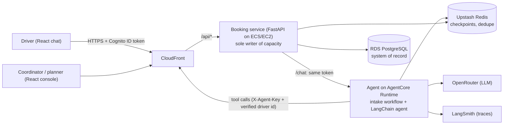

# Hand-in 3 · Working prototype

> What this shows (brief): *the conversation layer, the tools it calls and the state it keeps; library versions
> named in the README.* Code: this repository. Versions: [README → Pinned versions](../../README.md#pinned-versions).

**Live:** `https://drfltod746u4o.cloudfront.net` (Cognito sign-in; demo users and steps in
[TESTING.md](../TESTING.md)). **Local:** `uvicorn booking.api:app --port 8000`, `python -m agent.app serve`,
`cd web && npm run dev`.

## 1. Shape: the LLM talks, code decides

| Part | Workflow or agent? | Why |
| --- | --- | --- |
| Intake: dedupe, identify, store, extract | **Fixed workflow** | Same steps every message; no judgement |
| Dialogue: clarify, explain, compare, decide which tool next | **Agent** (LangChain v1 `create_agent`) | Turn order depends on what the driver says |
| Feasibility, holds, requests, confirm, release | **Deterministic code + DB transactions** | Must be correct under concurrency; never a model guess |
| Facility re-sequencing | **Tool** (CP-SAT vs dispatch rule) | Many trucks, many docks, explicit objective; proposals only |
| Confirmation, no-slot cases, safety, contradictions | **A person** (coordinator console) | Brief: a person approves or takes over |

## 2. The conversation layer

One driver message, end to end (`agent/intake.py`, `agent/graph.py`, `agent/middleware.py`):

1. **Identity.** The booking service verifies the Cognito ID token; the driver id comes only from the token's
   `custom:driver_id`. It forwards the same token to AgentCore, which validates it again (JWT inbound auth).
2. **Dedupe.** Redis `SET NX` on the channel message id **and** on driver + normalised text + 2-minute bucket
   (THR009 repeats THR001's text under a different id). A repeat gets the first reply; a unique index on
   `chat_messages.external_message_id` catches anything Redis misses.
3. **Rate limit** 20 messages/minute per driver. **Store** the message in the transcript (through the booking API).
4. **Extraction.** The model fills a Pydantic `DriverMessage` (intent, load reference, arrival time or window, delay
   minutes, repair-time flag, cause, latest finish, see vs book, chosen option). **Code** turns it into an ETA window
   and confidence: stated time = HIGH; stated range = MEDIUM on its late edge; "late by an hour" or a repair time =
   LOW, ask once. Facts said before the load is known carry forward. Extraction retries and falls back to a second
   model; if it is still unavailable, an ETA can only be recorded above LOW when the driver's own message states a
   clock time (a provider 429 must cost a question, never a wrong promise).
5. **Agent loop** with the case state injected and these deterministic guards:

| Middleware | Enforces |
| --- | --- |
| `CaseContextPrompt` | Before every model call: current stage, appointment, pending request, hold and ETA from the booking service |
| `WriteGuard` | No shipment tool before a load is linked; hold only an option the driver has **already seen** (same numbering); no hold/request on a LOW ETA |
| `ReplyPostCheck` | A reply saying booked/confirmed while the booking service isn't CONFIRMED is replaced with a true one; a dock no tool returned is blocked; a promised hand-off is created if the model forgot; options produced this turn but not listed are appended from the quote |
| `TurnOutcome` | Two failed clarifications -> coordinator hand-off; a run cut short by call limits -> fixed hand-off reply |
| Built-ins | Model retry + fallback model, tool and model call limits, summarisation for long threads |

6. **Reply** stored in the transcript; one LangSmith trace per message with every step nested.

**Prompt rules** (`agent/prompts.py`): never say booked unless CONFIRMED; never name a dock/time no tool returned;
options are "not reserved"; one question per message; ask only for which load, arrival time/window, whether the cause
is fixed, latest finish, see vs book; show options in the same turn once the ETA is usable; escalate on no slot,
contradictions, safety, penalties, disputes.

## 3. The tools it calls (`agent/tools.py`)

Every tool is a thin HTTP call to the booking service. Identity is in the runtime context, never a tool argument;
write tools carry an idempotency key `thread:tool:tool_call_id`.

| Tool | Reads / writes | Booking API | Returns | Guard |
| --- | --- | --- | --- | --- |
| `get_driver_context()` | read | `GET /drivers/{id}/context` | Live loads, current appointments, ETA window, check-in, data flags | - |
| `link_shipment(ref)` | write | `POST /threads/{id}/link` | Linked thread, or `NOT_YOURS` / `CANCELLED` | Ownership checked by the API |
| `record_eta(lo?, hi?, confidence?, cause?, cause_fixed?)` | write | `POST /eta` | ETA id; whether the current slot still fits; new options if it doesn't | Confidence capped at the code-resolved value |
| `find_slot_options(latest_finish?, after?)` | read (+ quote row) | `POST /quotes` | Up to 3 ranked options (not reserved) + why other docks were excluded; raises the hand-off itself if none | Needs a linked load |
| `hold_option(n)` | write | `POST /holds` | 5-min hold, or `SLOT_TAKEN` / `STALE` / `PRIORITY_RESERVED` / `NO_LONGER_FEASIBLE` with fresh options | Seen options only; not on a LOW ETA |
| `request_booking()` | write | `POST /bookings` | Pending request (old slot kept), or `HOLD_EXPIRED` / `SLOT_TAKEN` / `NO_LONGER_FEASIBLE` | Needs a hold |
| `get_booking_status()` | read | `GET /shipments/{id}/status` | NONE / HELD / PENDING / CONFIRMED in plain fields | - |
| `release_hold()` | write | `DELETE /holds/{id}` | Released | - |
| `escalate(reason_code, summary)` | write | `POST /handoffs` | Hand-off id, routing, channel status | - |
| `propose_schedule()` | read | `GET /shipments/{id}/proposal` | This truck's line of the facility plan, not reserved | Driver sees only their own truck |

## 4. The state it keeps

| Where | What | Lifetime |
| --- | --- | --- |
| Agent graph state (`CaseState`), checkpointed in Redis per thread | messages; `shipment_id`, `quote_id`, `options` (as shown), `hold_id`, `appointment_id`, `eta_confidence`, `facts`, `eta_hint`, `clarify_count`, `turn_sig`, `escalated` | 24 h TTL; `RedisSaver` stores channel values by version like LangGraph's InMemorySaver (Upstash has no RediSearch) |
| Redis (Upstash) | `idem:msg:*`, `idem:txt:*` (+ the first reply), `rl:{driver}`, pub/sub `facility:{id}` | 24 h / 60 s / live |
| PostgreSQL: the 18 supplied tables | chat_threads, chat_messages, eta_updates, driver_exceptions, appointments, slots... | System of record |
| PostgreSQL: added | `slot_holds` + `slot_hold_claims`, `appointment_slot_claims` (multi-slot), `slot_quotes` (options + slot versions), `eta_windows`, `handoffs`, `idempotency_keys`, `audit_log`, `sim_clock`, `appointment_slots.version` | System of record |

**Capacity state machine** (only "Requested" claims capacity, because only that writes a row the unique indexes guard):

```mermaid
stateDiagram-v2
  direction LR
  [*] --> Option: find_slot_options (nothing reserved)
  Option --> Held: driver picks a seen option (5 min, re-checked under row locks)
  Held --> Option: expired / released / STALE / SLOT_TAKEN / PRIORITY_RESERVED
  Held --> Requested: driver says yes (PENDING row; old slot kept)
  Requested --> Confirmed: coordinator confirms (one transaction: old CANCELLED, new CONFIRMED)
  Requested --> Handoff: rejected or lapsed (15 min / 30 min before start, min 5 min)
  Option --> Handoff: no feasible slot (raised by code)
```

Concurrency: every write runs in one Postgres transaction; the slots are row-locked in a fixed order
(`SELECT ... FOR UPDATE`), feasibility is re-checked under the lock, then claim rows are inserted; partial unique
indexes reject a second active claim on any slot even if application code were wrong. In a **surge** (>= 5 loads with
exception activity in 30 min) a slot shown to a higher-priority truck in the last 2 minutes is kept for it while it
decides.

## 5. Capacity layer, escalation, scheduler (what else ships)

* **Feasibility** (`booking/feasibility.py`): facility, OPEN slot, no dock event, dock type (reefer/heavy), weight,
  enough consecutive time for the unload, start >= ETA window late edge + 15 min and >= now, driver's latest finish,
  21:00 rule (approval), no claim/hold, no overrun from a neighbouring booking, no contradictory driver data.
* **Escalation** (`booking/handoffs.py`): a complete record (load, driver, ETA window, constraints, every dock checked
  with its reason, nearest out-of-policy option, current slot, data flags), routed to the facility shift manager in the
  console; email marked NOT_SENT and never treated as delivered.
* **Sweeper**: every 30 s expires holds and stale requests (-> hand-off) and re-offers freed slots by priority.
* **Scheduler** (`booking/scheduling/`): CP-SAT vs dispatch rule, same validator and objective; never worse than the
  rule, better at 6 of 9 snapshot times; proposals only ([comparison](../evidence/phase5_comparison.md)).
* **Console**: dock timeline, confirmation queue with lapse countdowns, hand-off records, live updates (SSE from
  Redis), planner clock/reset, facility re-plan panel.

## 6. Libraries (exact pins in `booking/requirements.txt`, `agent/requirements.txt`, `web/package.json`)

| Area | Versions |
| --- | --- |
| Runtime | Python 3.12, PostgreSQL 16, Node 20 LTS |
| Agent | langchain 1.5.0, langchain-core 1.8.1, langchain-openrouter 0.2.9, langgraph 1.2.22, langgraph-checkpoint 4.3.2, langsmith 0.14.17, bedrock-agentcore 1.26.0 |
| Booking | fastapi 0.163.1, starlette 1.10.0, uvicorn 0.54.0, pydantic 2.14.3, psycopg 3.3.9, psycopg-pool 3.3.3, PyJWT 2.15.1, boto3 1.44.3, redis 8.1.0, ortools 9.15.6755 |
| Web | react 18.3.1, vite 6.4.6, @vitejs/plugin-react 4.7.0, typescript 5.9.3 |
| Tests | pytest 9.2.0, fakeredis 2.40.0 |

## 7. Proof it works

| Evidence | Result |
| --- | --- |
| Automated tests (`pytest`) | all pass: feasibility, lifecycle, auth roles, surge, agent guardrails with a scripted model, scheduler, 100-round races ([output](../evidence/phase6_test_output.txt)) |
| Integrity proof (hand-in 5) | 100 rounds x 10 concurrent clients (threads and processes) through the HTTP API: exactly 1 winner every round; plus a race that bypasses app checks: the DB lets exactly 1 claim through ([phase 2 output](../evidence/phase2_test_output.txt)) |
| Scenario run (hand-in 4) | brief steps 1-7 + duplicates against the deployed system ([report](../evidence/phase6_scenarios.md)) |
